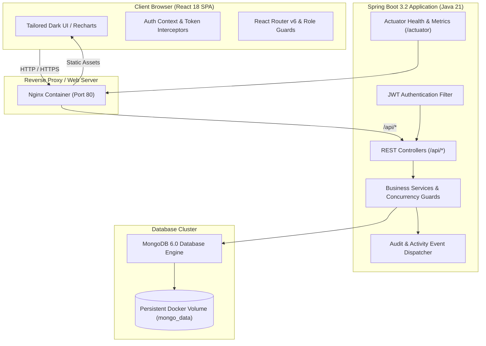
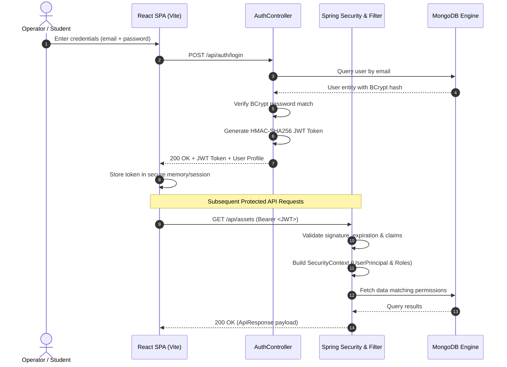
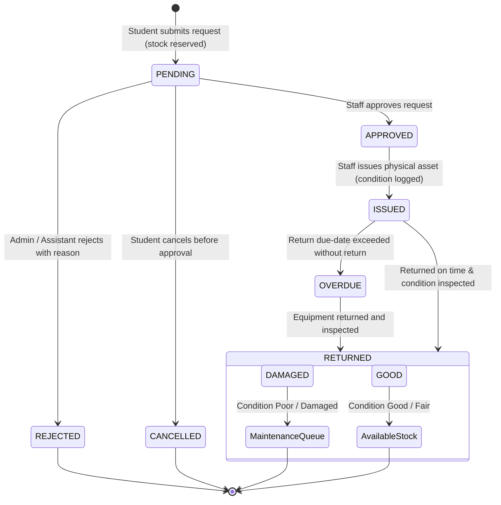
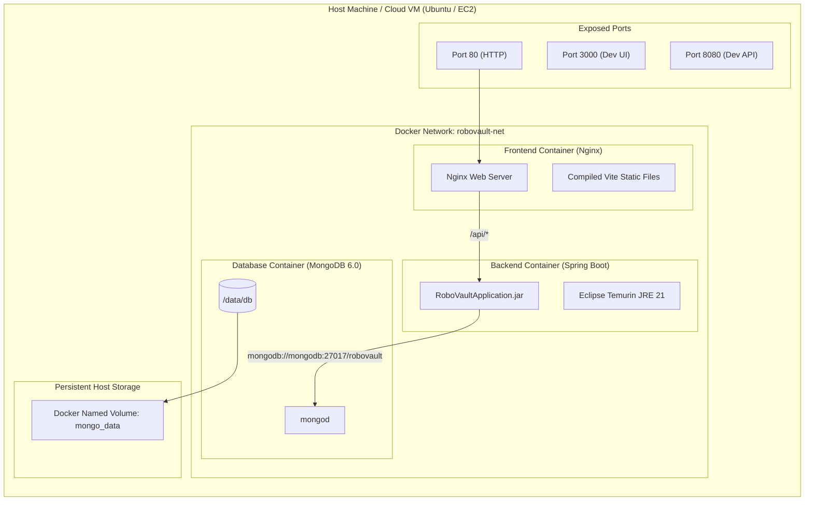

# RoboVault Architecture & System Design Documentation

## 1. System Overview

**RoboVault** is an enterprise-grade robotics laboratory asset, custody, and maintenance management platform. It streamlines equipment checkouts, return inspections, project allocations, and preventive/corrective maintenance workflows for academic and industrial research labs.

---

## 2. Authentication & Authorization Flow

RoboVault utilizes stateless HMAC-SHA256 JSON Web Tokens (JWT). All protected API operations evaluate user identity and assigned security roles (`ADMIN`, `LAB_ASSISTANT`, `FACULTY`, `STUDENT`).

---

## 3. Checkout, Issue & Inspection State Machine

Equipment custody follows a strict state transition model preventing double issuance, stock negative drift, and unaccounted equipment condition loss.

---

## 4. Multi-Container Docker Network Architecture

RoboVault isolates application tiers inside a dedicated Docker bridge network (`robovault-net`), shielding MongoDB from public exposure while exposing only standard web ports.

---

## 5. Security & Concurrency Design

1. **Atomic Concurrency Control**:
   - Equipment allocations and returns execute atomic increment/decrement operators (`$inc`) or synchronized transactional routines in MongoDB to eliminate race conditions under concurrent checkouts.
2. **Defensive Deletion Safeguards**:
   - Assets tied to active checkouts, uncompleted repairs, or dedicated project pools cannot be deleted; the system raises a `400 Bad Request` with actionable diagnostics.
3. **Role-Enforced Endpoint Boundaries**:
   - `@PreAuthorize("hasRole('ADMIN')")` secures sensitive administrative actions (user role alterations, account toggling).
   - `@PreAuthorize("hasAnyRole('ADMIN', 'LAB_ASSISTANT')")` permits inventory auditing and repair lifecycle operations.
4. **Immutable Audit Trails**:
   - Every mutation produces an asynchronous or transactional `ActivityLog` entry recording operator identity, target entity ID, action token, and payload metadata.
